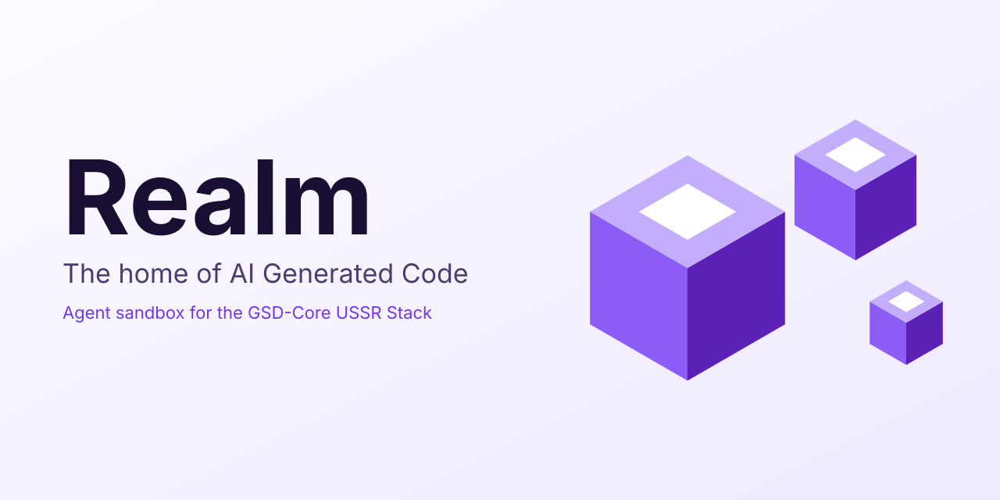

<p align="center">
  
</p>

<h1 align="center"> Realm</h1>

[](https://github.com/swcstudiospace/realm/actions/workflows/ci.yml) [](https://github.com/swcstudiospace/realm/releases) [](LICENSE) [](https://swcstudiospace.github.io/realm/)

<p align="center"><strong>Realm, the home of AI Generated Code.</strong></p>

## What it is

Realm is the agent sandbox component of the GSD-Core USSR Stack (Ultrathink, Substrate, Swarm, Realm). It runs an agent's execution and file mutations inside a locked-down sandbox, and it ships an Omp plugin, a standalone CLI with a long-running local daemon, and MCP and ACP surfaces. The MCP and ACP surfaces let other agent hosts, such as Muse Code, Claude Code, Grok Build, and Hermes Agent, use the same sandbox.

The core guarantee, under the fail-closed policy: every file mutation either lands inside the realm under policy or fails closed, and the user can see whether the realm is active or disconnected for the session. The policy `mode` defaults to `fail-closed`: while the realm is not active, the Omp guard refuses host `edit` and Realm `write` calls (with `REALM_NOT_ACTIVE`, or the code of the realm's state). That default is not containment of Omp's own tools: with the realm active, fail-closed mode asks Omp to remove its built-in tools outside the Realm allowlist, and Realm `write` replaces the built-in `write`. That is a guard, not containment: the spike recorded a `write` transport that survived removal of the built-in write, and the live check is pending (`docs/integration/omp.md`). Advisory mode, which lets host `edit` and Realm `write` through with a warning while the realm is not active and the daemon is reachable (with the daemon unreachable, Realm `write` refuses), requires the explicit value `"mode": "advisory"` in the policy file (`docs/policy-reference.md`).

**Upgrading.** This changes the default of earlier releases. A policy file with no `mode` key, or no policy file at all, now loads as `fail-closed`, so host `write` and `edit` calls that used to proceed with a warning are refused with `REALM_NOT_ACTIVE` while the realm is not active (start it with `realm up`, or `/realm-retry` in Omp). To keep the old behaviour, add `"mode": "advisory"` to `<state-dir>/policy.json`; to take the new default, change nothing. `realm status` and `realm up` print the mode in effect, and `realm doctor` names the mode and its source in its `policy-file` check, warns for an explicit `advisory`, and exits 0 whatever its checks report. See "Upgrading" in `docs/policy-reference.md`.

## Status

- v0.1.x was the first release line, for milestone v1.0 (a provisional name), and v0.2.x was the line of milestone v2.0. v0.3.x, for milestone v3.0, becomes the current line with its first release and is the only line that is supported.
- `realm up` binds the AgentOS driver from the configured digest-pinned image. The production stack is the OpenShell 0.1.5 gateway, the Realm compute driver, and rootless Podman 5.x (`docs/integration/openshell.md`).
- Linux is the only verified platform. Podman 5.x is required, and Realm does not install it.
- The Podman-gated production live suite and Omp status checks have versioned historical receipts in [OpenShell integration](docs/integration/openshell.md), [Omp integration](docs/integration/omp.md) and [ACP integration](docs/integration/acp.md). On 2026-10-31 the parent exercised compiled Realm 0.3.26 with a temporary matching rebuilt driver on rootless Podman 5.7.1: fresh generated-config `init` → active `up`/`status` → unbound `down`, then production crash/reap/reattach and real MCP exec/write/read (2 passed, 0 skipped). See the normalized transcript below. This is not installer provisioning or Omp containment proof. Other platforms and the Anda engine remain unverified live.

## Quick start

### Prepare the checkout and runtime

Use Node.js 22.13.0 or later and npm. From a local Realm checkout:

```sh
npm ci
npm run build
```

The package is private; nothing is published to npm. The commands below use
the built checkout directly, so no global `realm` installation is assumed.
Keep that checkout, its dependencies and `dist/` available.

`init` writes local configuration, not a runtime installer. Before `up`, the
runtime account needs:

- Linux, cgroups v2, rootless Podman 5.x and its active user API socket.
  Realm does not install or upgrade Podman.
- The OpenShell 0.1.5 CLI, a registered default gateway under that account's
  `HOME`, working gateway trust, and a configured Realm compute driver and
  supervisor. See [OpenShell integration](docs/integration/openshell.md).
- A locally available, digest-pinned AgentOS image matching the driver's
  `REALM_DRIVER_SANDBOX_IMAGE`. The observed reference below names an image
  in local Podman storage; it is not a registry download URL.
- A compute driver built for the shared-config contract. Driver and daemon
  must select the **same physical generated `config.json`**, with matching
  `HOME`/`XDG_CONFIG_HOME`, workspace and image. The removed legacy driver-root
  environment variables are not a configuration path.

The parent temporarily deployed the matching rebuilt driver for the observed
run, then restored the old service. That does not establish that a released
installer or package provisions this stack. Do not restart a shared driver
casually: its startup sweep is account-wide.

### Initialize and start

Choose the following absolute paths for the runtime account:

| Variable | Meaning |
| --- | --- |
| `REALM_CHECKOUT` | Built Realm checkout, with `dist/src/cli/main.js` |
| `WORKSPACE` | Existing project directory owned by that account |
| `STATE_DIR` | Dedicated private Realm state directory, outside the workspace |
| `CONFIG_HOME` | XDG config base; Realm writes `realm/config.json` beneath it |

`CONFIG_HOME` and `STATE_DIR` must be outside the workspace, and the workspace
must not be inside `STATE_DIR`. Use non-symlinked paths. Keep the state path
short enough for its Unix socket, `STATE_DIR/run/control.sock`. Retain the
runtime account's configured `HOME`; changing it also changes OpenShell's
gateway lookup.

```sh
REALM_CHECKOUT=/absolute/path/to/agent-realm
WORKSPACE=/absolute/path/to/project
STATE_DIR=/absolute/path/to/realm-state
CONFIG_HOME=/absolute/path/to/config-base
export XDG_CONFIG_HOME="$CONFIG_HOME"
REALM_IMAGE=localhost/realm-agentos@sha256:9511929b0b1a23120c30c04d2383317c7b8108ec8ee915e9a1538920e1c9596b

# Use the CLI from this checkout, not an older executable on PATH.
realm() { node "$REALM_CHECKOUT/dist/src/cli/main.js" "$@"; }
cd "$WORKSPACE"
realm init --image "$REALM_IMAGE" --workspace "$WORKSPACE" --state-dir "$STATE_DIR"
# Before up, the preconfigured matching driver must read this generated config.
realm up
realm status
realm down
```

Use that image reference only if it is actually provisioned for your driver;
otherwise pass your real matching digest pin, never a tag or invented digest.
The image digest above comes from the parent's actual 2026-10-31 lifecycle
capture, not a registry-publication or reproducible-build attestation.

Init creates `STATE_DIR`, its derived `secrets` and `sandboxes` directories
at 0700, and `CONFIG_HOME/realm/config.json` and `STATE_DIR/policy.json` at
0600. The policy explicitly selects `fail-closed`. Existing templates are
never overwritten. Unsafe existing private roots are refused, not silently
chmodded; existing workspace and ancestor modes are preserved. A failed
write reports template cleanup and any new private directories retained for
inspection. See [the Omp setup notes](docs/hosts/snippets/omp.md#initialize-realm-before-launching-omp).

`up` uses `--workspace` or the current directory, not the saved
`workspaceRoot`. The `cd` above is required for the captured no-argument
`realm up`; from another directory use `realm up --workspace "$WORKSPACE"`.
Start Omp in that same workspace. A `POLICY_DENIED` from the wrong directory
is not a reason to broaden the policy.

### Captured lifecycle transcript

Actual parent capture, 2026-10-31: compiled Realm **0.3.26**, Linux runtime
account uid 5002, rootless **Podman 5.7.1**, preconfigured OpenShell stack
and temporary matching rebuilt compute driver. All four commands exited 0
with empty stderr. Only the host-local paths have been normalized below:
`CONFIG_HOME`, `STATE_DIR` and `WORKSPACE` are literal placeholders for the
paths defined above, not JSON values to copy into a configuration file.

```text
$ realm init --image localhost/realm-agentos@sha256:9511929b0b1a23120c30c04d2383317c7b8108ec8ee915e9a1538920e1c9596b --workspace WORKSPACE --state-dir STATE_DIR
{"config":"CONFIG_HOME/realm/config.json","policy":"STATE_DIR/policy.json","stateDir":"STATE_DIR","mode":"fail-closed"}
$ realm up
{"snapshot":{"state":"active","reason":"container running","lastTransitionAt":"2026-10-31T05:48:21.267Z"},"display":{"label":"realm active","degraded":false,"reason":"container running","lastTransitionAt":"2026-10-31T05:48:21.267Z"},"mode":"fail-closed"}
$ realm status
{"snapshot":{"state":"active","reason":"container running","lastTransitionAt":"2026-10-31T05:48:21.267Z"},"display":{"label":"realm active","degraded":false,"reason":"container running","lastTransitionAt":"2026-10-31T05:48:21.267Z"},"mode":"fail-closed"}
$ realm down
{"snapshot":{"state":"unbound","reason":"no workspace","lastTransitionAt":"2026-10-31T05:48:37.069Z"},"display":{"label":"realm disconnected","degraded":false,"reason":"no workspace","lastTransitionAt":"2026-10-31T05:48:37.069Z"},"mode":"fail-closed"}
```

There was exactly one actual rootless container while active. Driver and
daemon used the freshly generated config, with no legacy root environment
variables and no manual JSON edits. The existing production live scenarios 5
(real daemon crash, reap and reattach) and 6 (actual MCP exec/write/read)
then passed: **2 passed, 0 failed, 0 skipped**. Cleanup restored the original
driver service active, left zero containers and removed the owned temporary
config; no permanent unit or package changes were made. The older stale-image
failure is historical, not the outcome of this run.

This transcript is lifecycle/MCP evidence, not a model-driven Omp sandbox
write or a clean built-Realm warm-network trace. Those remain separate proof
obligations. These documentation edits still require the parent's docs checks.

### Diagnose and apply only safe local fixes

With a valid generated config selected by the same `XDG_CONFIG_HOME`:

```sh
realm doctor
realm doctor --fix --dry-run
# Review the proposed actions, then apply if appropriate.
realm doctor --fix
realm doctor --fix
```

`--dry-run` requires `--fix`, in that order. Fix mode operates locally even
if a daemon is running; it does not start or ask the daemon to repair things.
Its only repair targets are `STATE_DIR`, `STATE_DIR/run` and
`STATE_DIR/sessions`: create missing directories or set their mode to 0700.
The parent directory must already exist. It refuses symlinked paths,
foreign-owned or unreadable directories, and protected home/workspace
locations. It never repairs the gateway, Podman, driver, workspace, secrets
or sandbox roots. Follow the named diagnostic's prose for those.

Stdout is JSON with `dryRun`, `fixes` and `checks`; stderr describes proposed
or applied actions and any refusal. An idempotent repeat has `fixes: []`.
Review the checks themselves: exit 0 is not a claim that the runtime is
healthy. A later failure reports already-applied actions rather than
pretending nothing changed. Parent evidence on 2026-10-31 includes **31
nonroot doctor tests passed, 0 skipped**, plus actual CLI dry-run, apply and
idempotence; that predates these docs edits.

### Install the Omp extension from a local checkout

The verified installation scope is an **isolated local link on Omp 18.12.6**
(2026-10-30, package then 0.3.24), not registry or marketplace publication.
With `REALM_CHECKOUT` set as above, choose a fresh isolated directory:

```sh
OMP_HOME=/absolute/path/to/isolated-omp-home
mkdir -p "$OMP_HOME" "$OMP_HOME/agent" "$OMP_HOME/config"
(
  export HOME="$OMP_HOME"
  export PI_CODING_AGENT_DIR="$OMP_HOME/agent"
  export XDG_CONFIG_HOME="$OMP_HOME/config"
  omp plugin install --dry-run "$REALM_CHECKOUT" --json
  omp plugin install "$REALM_CHECKOUT"
  omp plugin list --json
)
```

Review the dry run before applying it. A path install links the checkout; it
does not copy a release or provision Realm. The retained record reported
action `link` and an enabled `agent-realm` entry with
`extensions: ["./dist/src/omp/extension.js"]`. `--scope=user` was ignored for
local paths; it is a marketplace option. No permanent install into the real
Omp home, registry install or current-package installed-load pass is claimed.
An isolated Omp home also lacks the production OpenShell gateway/config;
do not confuse this link rehearsal with the configured runtime above.
See [the full Omp snippet](docs/hosts/snippets/omp.md) for one-session loading,
the historical install receipt and shared-config prerequisites.

## Hosts

Realm ships one integration per host, each under `docs/hosts/` with a snippet:

- Omp: a Realm extension, loaded from `dist/src/omp/extension.js` (see `docs/hosts/snippets/omp.md`). It attaches the sandbox when a session starts, shows its status, and gates Omp's `edit` call and Realm's `write`: under the default `fail-closed` mode it refuses them while the realm is not active, and under an explicit `advisory` mode it warns and lets them through when the daemon is reachable (with the daemon unreachable, Realm `write` refuses). With the realm active, fail-closed mode asks Omp to remove its built-in tools outside the Realm allowlist; that is a guard, not containment, until the live check passes, and the session directory must be the configured workspace root (`docs/integration/omp-lifecycle-runbook.md`).
- Claude Code and Grok Build: the shared plugin bundle `adapters/claude-plugin`, plus an MCP entry that runs `realm mcp`.
- Muse Code: the plugin bundle `adapters/muse-code`, plus an `mcp_servers` entry.
- Hermes Agent: the MCP-only plugin bundle `adapters/hermes-agent`.
- Prime Agent: the package `adapters/prime-agent`, plus an MCP entry.

Each host bundle has historical isolated validator evidence; installing one
does not provision the runtime or verify a current sandbox. Use a configured
`realm` executable or the built CLI by absolute path as shown above.

See [docs/integration/hosts.md](docs/integration/hosts.md) for the host tiers.

## Documentation

- [Documentation site](https://swcstudiospace.github.io/realm/)
- [CHANGELOG.md](CHANGELOG.md)
- [AGENTS.md](AGENTS.md): for AI agents and contributors
- [CONTRIBUTING.md](CONTRIBUTING.md)
- [SECURITY.md](SECURITY.md)

## Versioning

Versions follow `0.<milestone>.<part>`. Each green push to `main` publishes the next part as a GitHub release, with the npm pack tarball attached.

## Licence

Copyright (C) 2026 Spectrum Web Co/swcstudiospace.

Licensed under the GNU Affero General Public License v3.0 only (AGPL-3.0-only). See [LICENSE](LICENSE) and [NOTICE](NOTICE).
