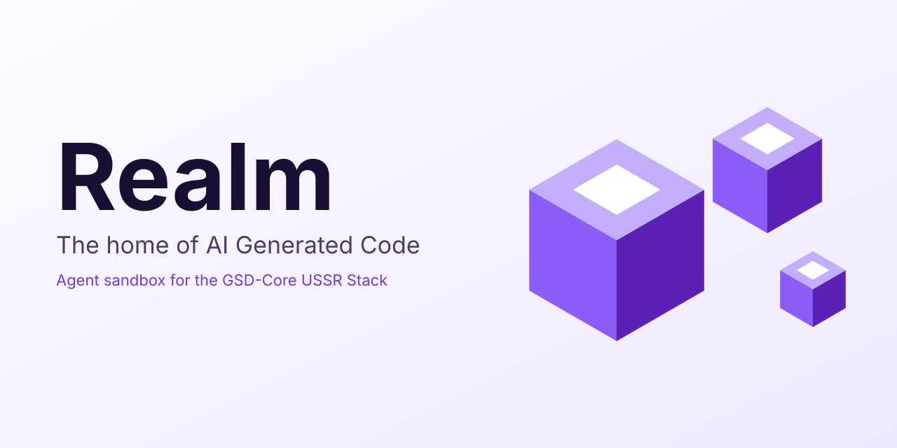
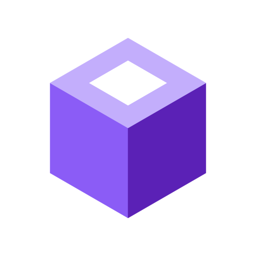

<p align="center">
  
</p>

<h1 align="center"> Realm</h1>

[](https://github.com/swcstudiospace/realm/actions/workflows/ci.yml) [](https://github.com/swcstudiospace/realm/releases) [](LICENSE) [](https://swcstudiospace.github.io/realm/)

<p align="center"><strong>Realm, the home of AI Generated Code.</strong></p>

## What it is

Realm is the agent sandbox component of the GSD-Core USSR Stack (Ultrathink, Substrate, Swarm, Realm). It runs an agent's execution and file mutations inside a locked-down sandbox, and it ships an Omp plugin, a standalone CLI with a long-running local daemon, and MCP and ACP surfaces. The MCP and ACP surfaces let other agent hosts, such as Muse Code, Claude Code, Grok Build, and Hermes Agent, use the same sandbox.

The core guarantee, under the fail-closed policy: every file mutation either lands inside the realm under policy or fails closed, and the user can see whether the realm is active or disconnected for the session. The default advisory mode does not contain: while the realm is disconnected, the Omp guard warns and allows host write and edit calls. Containment requires opting into fail-closed.

## Status

- v0.1.x is the first release line, for milestone v1.0 (a provisional name).
- v1.0 fails closed. `realm up` refuses with `AGENTOS_NOT_CONFIGURED` until an AgentOS driver is bound. That driver is deferred to a follow-up milestone.
- Podman-gated and host-gated checks await human verification on a Podman 5.x host.

## Quick start

Prerequisites: Node.js 22.13.0 or later, and npm. Linux is the verified platform.

```sh
npm ci
npm run build
npm test
```

## Documentation

- [Documentation site](https://swcstudiospace.github.io/realm/)
- [CHANGELOG.md](CHANGELOG.md)
- [AGENTS.md](AGENTS.md): for AI agents and contributors
- [CONTRIBUTING.md](CONTRIBUTING.md)
- [SECURITY.md](SECURITY.md)

## Versioning

Versions follow `0.<milestone>.<part>`. Each green push to `main` publishes the next part as a GitHub release, with the npm pack tarball attached.

## Licence

Copyright (C) 2026 Spectrum Web Co/swcstudiospace.

Licensed under the GNU Affero General Public License v3.0 only (AGPL-3.0-only). See [LICENSE](LICENSE) and [NOTICE](NOTICE).
