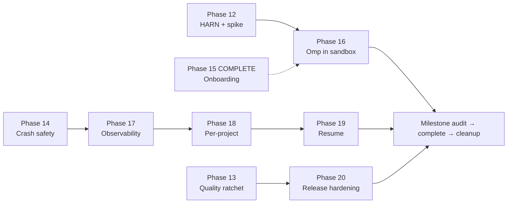

# Blueprint — Realm v3.0 Containment by Default (Outstanding Phases)

**Branch:** `gsd/phase-15-complete` · **Correlation:** `c8fd136c-b9a0-459e-bc27-e2c578d77a08` · **Task:** `Tc8fd-arch` · **Capability:** `design.blueprint`
**Status:** IN_REVIEW (provisional for HARN-03, live-gated proof on Podman 5.x, and A10 co-sign; contract check skipped per brief — run by parent after join)
**Sources:** `docs/requirements/spec.md` (v1.0.0), `docs/requirements/stories.md` (v1.0.0), `docs/acceptance.md` (AC-1..AC-32), `.planning/ROADMAP.md`, `.planning/phases/RECOVERY-2026-10-31.md` (SUPERSEDED 2026-11-01) + `AGENTS.md`.
**Archive note:** RECOVERY-2026-10-31 is superseded by owner decision 2026-11-01 (start from phase 13, gsd-autonomous governs). Its P0..P20 recipes and 52-requirement matrix remain planning inputs; its edit-only/no-commit rules do not bind execution. HARN-03 grey-area (§8) survives the supersession unchanged.

This document is the single-writer `architecture.blueprint` for v3.0 phases 12, 13, 14, 16, 17, 18, 19, 20. Phase 15 (ONB-01..ONB-07, DEF-01..DEF-02) is complete 2026-11-14 and is not re-verified here. No product code is written or committed under this task.

## 1. Purpose and scope

Every file mutation by an agent either lands inside the realm under policy or fails closed; the operator can always see whether the realm is active or disconnected. Under the fail-closed default (D4), host `edit` or Realm `write` while disconnected refuses with `REALM_NOT_ACTIVE`; no silent unsandboxed mutation is permitted.

Out of scope: product source, schema DDL, UX tokens, release commands, IaC changes, `CHANGELOG.md`/`package.json` version edits (release job owns them), `docs/specs/realm-spec.xml` (owner-directed edits only), `LICENSE`/`NOTICE` except by owner instruction.

## 2. System context (C4 Level 1)


Trust zones: **host operator** (Operator, CLI, Omp host) · **daemon surface** (RealmDaemon, ControlSocket) · **policy core** (PolicyEngine, AuditLog, FileSystemGuard) · **sandbox runtime** (ComputeDriver, SandboxContainer, OpenShellGateway, AgentOS) · **CI / tracking** (CIPipeline, Greptile, LinearTracker, GSDPipeline). Crossings are listed in §9 and `threat-model.md`.

## 3. Container model and coupling budget

15 containers, 17 distinct relations, max fan-out 3 (measured by `arch_c4_fanout`: `container_count=15`, `relation_count=17`, `max_fan_out=3`, `over_budget=[]`, `isolated=[]`). Fan-out budget: **8** distinct containers per container. Any future container exceeding 8 requires an ADR; no silent accept. Containers: Operator, OmpHost, RealmDaemon, ControlSocket, LifecycleController, ToolDispatcher, PolicyEngine, AuditLog, ComputeDriver, SandboxContainer, OpenShellGateway, AndaEngine, CIPipeline, GSDPipeline, LinearTracker.

Coupling rule: surfaces never talk to the sandbox directly; all tool calls pass ToolDispatcher → PolicyEngine → AuditLog admission → sandbox. Daemon owns lifecycle; driver owns container creation; gateway owns network egress.

## 4. Module layering

`layer_order` (outermost → innermost; a module may depend on its own layer or any later one):

```
surface (0) → orchestration (1) → runtime (2) → domain (3) → platform (4)
```

| Layer | Modules (single-writer zones) |
|---|---|
| surface | `omp-plugin`, `mcp-server`, `acp-agent`, `cli` — host adapters only, no tool logic |
| orchestration | `lifecycle-controller`, `tools-dispatcher`, `daemon`, `session-store` — state machine, queue, socket |
| runtime | `libpod-client`, `openshell-adapter`, `agentos-driver`, `anda-client`, `hardening-verifier` — Podman/OpenShell/AgentOS/Anda edges |
| domain | `policy-engine`, `fs-canonical`, `audit-chain`, `contract-validator` — pure policy/fs/audit logic |
| platform | `core-errors`, `core-timeout`, `core-events`, `observe-logger`, `observe-metrics` — RealmError catalogue, `withTimeout`, logger/metrics primitives |

Measured by `arch_layer_violations`: `violation_count=0`, `checked_edges=17`, `unassigned=[]`. Measured by `arch_cycle_check`: `has_cycle=false` (12 nodes in the sampled edge set). Any new edge must be added to the fitness set; an upward edge or a cycle blocks downstream CLAIMED tasks.

## 5. Phase DAG (v3.0 lanes)

Three lanes share no mutable state and may run in parallel; inside a lane order is strict. Live runs on the realm account execute under one live lock at a time (startup reap is account-wide).



| Lane | Sequence | Rationale |
|---|---|---|
| Omp lane | 12 → 16 (15 complete between) | Spike proves what Omp enforces; 16 implements only the proved mechanism. |
| Runtime lane | 14 → 17 → 18 → 19 | Reconciliation lines (14) must be covered by the chain (17); adoption is per-session (18 before 19). |
| Pipeline lane | 13 → 20 | 20 alters the release path every earlier ship uses; it runs last. |

Milestone join rules: audit records all 52 v3.0 IDs as satisfied/carried/superseded with 0 silent gaps; `gsd-tools milestone complete` runs only after a dry run that exits 0; cleanup removes scratch profiles and worktrees per inventory; release line is 0.3.x, first v3.0 release 0.3.0.

Intra-phase dependency contract (from RECOVERY matrix, carried forward): project contract → identity → selection; selection + startup-common-log → daemon; daemon + driver + omp-mode-state → all callers; resume-verifier → scratch-volume → scratch-runtime-wiring → checkpoint → checkpoint-cli; production-acceptance waits for checkpoint-cli + audit-checkpoint-cli + quality-release-repair; production-acceptance → release-removed-features → release-rollback-docs. `src/runtime/driver/service.ts` does not exist; the boundary is `compute-driver.ts`/`server.ts`. A01 must correct signed ownership for any path mismatch; workers never silently substitute paths.

## 6. Architecture invariants (non-negotiable)

Carried from AGENTS.md and `src/core/errors.ts` (31 codes, frozen catalogue):

1. **Strict TypeScript, ESM, single package.** `tsconfig.json` enables `strict`, `noUncheckedIndexedAccess`, `exactOptionalPropertyTypes`, `noUnusedLocals`. Tests use `node:test`; no source-text tests.
2. **RealmError + codes/retryable.** Every error is a `RealmError` with a catalogue `code` (`ERROR_CODES`, 31 codes incl. `OPENSHELL_GATEWAY_LOST`), a human-readable `reason`, and a `retryable` flag; optional `causeCode` is itself a catalogue code. Raw runtime text never enters an error. Only `src/core/errors.ts` defines retryable values.
3. **`withTimeout` on every async boundary** (`src/core/timeout.ts`; `TOOL_TIMEOUT`, `DAEMON_START_TIMEOUT`).
4. **Fail-closed default (D4).** Policy with no `mode` loads as fail-closed. Advisory (warn-and-allow) is explicit opt-in, never called the default; `scripts/check/default-mode.mjs` enforces prose.
5. **Audit redaction.** No secrets or env in audit/log; redaction sentinel present; JSONL lines carry level, fixed code field, correlation id. Hash chain `seq`/`prev` with `realm audit verify` (OBS-01).
6. **Atomic writes.** Interrupted write leaves the original intact (`WRITE_NOT_ATOMIC`); orphan temp sweep removes only 1 exact-name pattern, never follows symlinks, with audit lines (CRASH-01/05).
7. **Bounded queues.** Tool queue wait bounded by `toolQueueMs`; no unbounded buffer.
8. **Module-size ratchet.** `src/**/*.ts` > 1000 lines fails `check:gates` unless allowlisted with a ceiling; never raise a ceiling silently — split the file or raise in the same PR with the new count stated.
9. **`process.env` only at 4 entry edges:** `src/cli/main.ts`, `src/daemon/main.ts`, `src/omp/extension.ts`, `src/runtime/driver/main.ts`. Other modules take env as an argument.
10. **No suppression comments** (`@ts-ignore`, `@ts-expect-error`, `@ts-nocheck` banned); no silent catch beyond the 10 named QUAL-01 exceptions.
11. **No new dependency** without justification, licence and maintenance checks (CONTRIBUTING.md). Scripts use Node built-ins only except `export-usage*.mjs` (existing `typescript` devDependency).
12. **No host-local absolute paths** in committed files (no home-directory, temporary-directory, or Users-directory paths); `check:docs` enforces for published docs.
13. **Single tool contract.** Omp plugin, MCP and ACP expose the same `tools.dispatch`/`contract/tools.schema.json` shape; callable tools are exactly 5 (exec, read, write, list, status), `@boulies/sell`, retry stays a command, 0 glob tools.
14. **Sandbox hardening.** Rootless only, digest-pinned, non-privileged, capabilities dropped, read-only root + tmpfs scratch, CPU/memory/PID limits, 1 container per session (`realm-<sessionId>`), `/workspace` the only project bind plus session scratch `/scratch` (RES-03). Control socket dir 0700, socket 0600; 0 network listeners on the daemon; metrics over control socket only.
15. **Conventional Commit subjects** (`feat`, `fix`, `perf`, `refactor`, `docs`, `test`, `build`, `ci`, `chore`, `security`), changelog grouped by type.

## 7. NFR bindings

Every NFR from A02 spec §6 is bound to a measurable contract clause or component budget. Detail in `nfr-allocation.md`; measured by `arch_nfr_allocation`: `coverage_pct=100`, `fully_allocated=true` (5 NFRs, all allocated). Live measurements are pending Podman 5.x proof (§8) — `arch_nfr_budget` with no measurements reports `within_budget=false`, `unmeasured=[startup_s, control_read_s]`, which is the honest fail-closed reading, not a pass.

| NFR | Kind | Binding (contract clause / component budget) | Limit |
|---|---|---|---|
| NFR-P1 (perf) | quantitative | Component budget: `realm up` → active (startup budget) | 200 s on 5.7.1 stack |
| NFR-P1 (perf) | quantitative | Component budget: control-socket read | 10 s, 1 response |
| NFR-S1 (security) | quantitative | Clause: `API-RealmControl /tools/write` fail-closed refusal | 0 successes while disconnected |
| NFR-S1 (security) | qualitative | Component budget: socket 0700/0600, 0 privileged, 0 host sockets | 0 violations |
| NFR-A1 (a11y) | qualitative | Clause: `API-RealmControl /status` label enum (realm active / realm disconnected) + color-independent cue | 1 of 2 labels, distinguishable without color |
| NFR-I1 (i18n) | quantitative | Clause: `API-ToolResult` frozen catalogue codes in C + en_US, English operator text | 0 locale-format parses |
| NFR-C1 (compliance) | qualitative | Clause: `API-AuditLine` redaction sentinel + JSONL shape | 0 off-machine telemetry, 0 PII fields, AGPL-3.0-only |

## 8. HARN-03 grey-area, Podman 5.x, protected paths

**HARN-03 (owner-blocked, surfaced never faked).** Recorded default-configuration warm run FAILED (38 external + 6 DNS = 44 offenders on 18.14.2; `127.0.0.1:9931` EINPROGRESS on 18.16.0). The only pass uses the `LLAMA_CPP_BASE_URL` lever in a proxied scripted configuration, which the record states is not the default configuration. A refusing-proxy observation (0/0/7) is narrower evidence, not a clean warm pass. An owner ruling is required on (a) whether port 9931 joins the allowlist and (b) whether the lever counts as passing the zero-offender acceptance. Until that ruling, AC-3 stays provisional and the zero-offender criterion is not relaxed. See `adr-index.md` ADR-0006. Cold and missing-prerequisite outcomes are named skips, never passes.

**Podman 5.x.** Supported stack is rootless Podman 5.x (realm account 5.7.1, OpenShell 0.1.5 gateway, Realm compute driver). This checkout host reports Podman 4.9.3, so live-gated proof cannot run here; Realm never installs or upgrades Podman. Podman-gated suites skip with `PODMAN_UNSUPPORTED_VERSION` / `PODMAN_MISSING`. Live acceptance runs on the realm account.

**Protected paths (human review required).** `.github/workflows/**`, `release/**`, `scripts/release/**`, `LICENSE`, `NOTICE`. Each D6 pull request cites D6 in its body.

**Dirty-tree preservation.** Checkout is on `gsd/phase-15-complete` and may carry owner WIP (`src/audit/log.ts`, `src/runtime/config.ts`). Never hard-reset, never discard unowned changes, never edit files outside the assigned zone; use absolute paths in subagent handovers.

**Carried, not in v3.0:** FS-02 (approximation; QR-07 adds confidence only), ANDA-01..04 (engine licence), PRD-DRV-01 (except MULTI-04 scope), UI-01 (accepted limitation). Excluded: TD-06, TD-10 (owner-only repo settings).

## 9. Threat model summary

Full STRIDE grid in `threat-model.md` (A10 co-sign pending — `verification.status=partial` until then). Boundary crossings: Operator→Daemon (spoof/tamper of control socket), Daemon→Sandbox (container escape), Sandbox→Gateway (egress), ToolDispatcher→AuditLog (tamper/repudiation), CI→Release (provenance). High-risk crossings awaiting A10 co-sign: Daemon→Sandbox containment (guard vs containment per D3 — spike-proved `write` transport survived removal of built-in `write`, so claims follow what the spike proves), Sandbox→Gateway egress (default-deny + IPv6 disabled), AuditLog integrity (seq/prev chain). No threat is marked accepted by A03; residual-risk acceptance is A10-only.

Compliance mapping: PCI network segmentation → OpenShell egress allowlist + IPv6 disabled + host-networking config refusal; supply-chain → SBOM + attestation (`gh attestation verify`) + SHA256SUMS; AGPL-3.0-only preserved; vulnerability reports via private GitHub reporting (`SECURITY.md`).

## 10. Tech stack selection

| Concern | Choice (golden path) | Supply-chain evidence | Level |
|---|---|---|---|
| Runtime | Node.js 22.13.0+ (CI 22.x/24.x), strict TS ESM, single package | `package-lock.json` pinned; `npm audit --omit=dev --audit-level=high` in CI audit job | L2 |
| Tests | `node:test` + `--experimental-test-coverage` (floors for `src/fs`, `src/core`, `src/tools`) + `fast-check` (200 runs, fixed seed) | `fast-check` devDependency; mutation via `scripts/mutation/run.mjs` (non-blocking, covers `src/fs`, `src/core/policy.ts`, `src/audit/redact.ts`) — Stryker not installed (188-package tree, unproven fit) | L2 |
| Container runtime | Rootless Podman 5.x, digest-pinned image (`sandbox/expected-digests.json`), `runc` | Image digest pinned; built via `npm run build:image` (not in CI); Realm never installs/upgrades Podman | L2 |
| Sandbox supervisor | OpenShell 0.1.5 gateway, Realm compute driver (gRPC on user-only socket), AgentOS as `openshell sandbox exec` child | OpenShell verbs pinned and re-verified 2026-10-26 (`sandbox create`/`exec`/`status`); Ada/Anda via HTTP, no shim | L2 |
| IDL | Vendored protos in tarball with provenance (PRD-LIB-01); exact pins | Vendored protos + provenance recorded in tarball | L2 |
| Release | GitHub Actions build (contents:read) → publish (4 write grants, 0 npm install/build/pack), `gh attestation verify` | SBOM + SHA256SUMS + tarball attested; Dependabot `github-actions`+`npm` root+`site/`; `npm audit` gate | L2 |

No new first-party dependency is introduced by this blueprint. Any future pick outside this table is an ADR; a pick adding infrastructure or a first-party dependency is L3 → BLOCKED `human-approval: novel_infrastructure`. Licence matrix: AGPL-3.0-only (Realm) + Apache-2.0 material listed in `NOTICE`/`licenses/` — no new licence compatibility risk without an ADR.

## 11. GSD pipeline (discuss → plan → execute → audit → complete → cleanup)

Every outstanding phase follows `gsd-autonomous`:

```
discuss → plan → execute (+ STATE/ROADMAP update in same PR) → verify (parent after join)
  → milestone audit (all 52 IDs satisfied/carried/superseded, 0 silent gaps)
  → milestone complete (dry run exit 0 first) → cleanup (scratch profiles + worktrees per inventory)
```

Parent verifies after all owners land; no dependent dispatch before actual parent evidence. State machine for each phase issue: `brief drafted → discussed → planned → executed → verified → audited → completed → cleaned up`. A phase cannot enter CLAIMED/IMPLEMENTATION until its contract ( §12 ) is IN_REVIEW and the relevant ADR is accepted.

## 12. Contracts (consumed by A05/A06/A07/A08, pinned by digest)

| Contract | File | Version | Consumers | Key clauses |
|---|---|---|---|---|
| API-RealmControl | `contracts/api-realm-control.yaml` (OpenAPI 3.1) | 1.0.0 (7 ops) | A05, A06, A07, A08 | `/up` 200 s budget, `/status` label enum + gateway-loss code distinct from `AGENTOS_CRASH_LOOP`, `/tools/write` fail-closed refusal, `/audit/verify` seq/prev, `/control/metrics` socket-only, `/checkpoint/restore` byte-exact |
| API-GsdLinear | `contracts/api-gsd-linear.yaml` (OpenAPI 3.1) | 1.0.0 (5 ops) | A05, A07, A08 | Phase issue lifecycle, sub-issue per plan/requirement, dedup scan (`SPE-*` list → 0 duplicates), collapsible Agent notes, per-phase ship record |

Pin consumers to the contract digest (computed by parent after join — see §15). Keep N-1 compatibility for the 30-day deprecation window. Any breaking change requires a major bump + migration plan + consumer acks (A05/A06) → L3 → BLOCKED.

`arch_contract_ops` (RealmControl): `operations=7`. `arch_field_breaks` (sample response addition of `correlationId`): `breaking_change=false`, `additive=["added field correlationId"]`. `arch_semver_bump` 1.0.0 → 1.1.0 additive: `bump=minor`, `required_bump=minor`, `compliant=true`. The contract check script (`arch_contract_check.py`) was not run — skipped per brief instruction to skip gates; parent runs it after join with `--base` against the prior revision.

## 13. Linear programming model (A01 to execute)

Dedup scan first (read-only): `list_issues` for `SPE-*`, matching phase id + title keywords; reuse when a phase title already exists; never create a second issue for one phase. Create only when the scan returns 0 matches for that phase.

- **8 phase issues** (titles 1 short line, e.g. `Phase 12: scripted harness and spike`): phases 12, 13, 14, 16, 17, 18, 19, 20.
- **33 sub-issues** (1 per plan): Phase 12 → 3 (12-01..03), Phase 13 → 1 (13-01), Phase 14 → 1 (14-01), Phase 16 → 4 (16-01..04), Phase 17 → 5 (17-01..05), Phase 18 → 15 (18-01..14 + 18-04b), Phase 19 → 1 (19-01), Phase 20 → 3 (20-01..03). Total **33**.
- Each issue links exactly 1 phase id, 1+ plan ids, 1+ requirement ids; detail lives in 1 collapsible `+++ Agent notes` section per issue (linked phase/plan/requirement ids, acceptance counts).
- No close, no status change and no Tracking write is performed by the architecture task. A02 spec §7 parenthetical (per-requirement split for phases 13/14/19 when >4 ids) is a reviewer option; the normative count for handover is 33. If reviewers prefer the split, issue a superseding ADR with the revised count before creating issues.

## 14. PR / ship / Greptile / CI

Branch from `main`; every change lands through a pull request. `ci.yml` must be green (verify including typecheck, lint, unit, integration and script tests, docs, gate-closure, build, pack and MCP checks on Node 22.x and 24.x; site build; audit), Greptile must report 5 of 5 with 0 open comments, and the merge must run once through the ultrathink ship flow with squash set to match the pull request shape. A `gh pr merge` from a shell is forbidden.

Gates (all exit 0 before review): `typecheck`, `lint`, `test`, `build`, `check:docs`, `check:gates`, `check:pack`, `check:mcp`. Human review required for protected paths (§8); each D6 PR cites D6. PRs never edit `CHANGELOG.md` or version fields (`package.json`, `package-lock.json`, 4 adapter manifests) — the release job owns them. Never force-push `main`; never rewrite history without an explicit owner decision.

## 15. Fitness functions (CI)

Any CI violation on main blocks further downstream CLAIMED tasks.

| # | Function | Check | Budget / rule |
|---|---|---|---|
| F1 | Layer direction | `arch_layer_violations` on the edge set in §4 | 0 violations |
| F2 | Acyclicity | `arch_cycle_check` | `has_cycle=false` |
| F3 | Coupling | `arch_c4_fanout` | fan-out ≤ 8 per container; 0 isolated unless intended |
| F4 | NFR allocation | `arch_nfr_allocation` | `fully_allocated=true`, coverage 100% |
| F5 | NFR budget | `arch_nfr_budget` vs live measurements | within budget or named skip (skip ≠ pass) |
| F6 | Contract conformance | `arch_contract_check` + `arch_semver_bump` + `arch_field_breaks` | semver-compliant, no breaking without L3 |
| F7 | Module ratchet | `scripts/check/module-size.mjs` under `check:gates` | >1000 lines needs allowlist ceiling |
| F8 | Export hygiene | `scripts/check/export-usage-gate.mjs` | 0 self-only/test-only without allowlist reason |
| F9 | Gate closure | `scripts/check/gate-closure.mjs` | exec-gate closure reaches 0 forbidden modules, 0 `child_process` |
| F10 | Coverage floors | `scripts/check/coverage.mjs` vs `coverage-floors.json` | `src/fs`, `src/core`, `src/tools` floors ratchet; raised floor exits 1 with BELOW |

Current fitness state (read-only checks, this task): F1 pass (0 violations), F2 pass (acyclic), F3 pass (15 containers, max fan-out 3, 0 over budget, 0 isolated), F4 pass (100% allocated), F5 unverified (live measurements pending Podman 5.x — honest `within_budget=false`), F6 unverified (script skipped per brief; registry ops/semver/field checks pass), F7–F10 not run (parent owns gates after join).

## 16. What was decided, what is UNVERIFIED

Decided (L2, catalog patterns): three-lane DAG with 20 last; fail-closed default; scripted-provider oracle for OMPX-01..05; per-session `realm-<sessionId>` identity with re-adoption under the 14-check verifier; seq/prev audit chain; quality ratchet (audit, pack-smoke, coverage floors, fake-clock, fast-check, mutation); 33-sub-issue Linear model; fan-out budget 8; layer order in §4.

UNVERIFIED (never inferred from a skipped tool): contract check (`arch_contract_check` script not run — parent runs after join); live NFR measurements (Podman 5.x realm account only); HARN-03 zero-offender acceptance (awaiting owner ruling on 9931 + lever); OMPX-05 /workspace + host + audit pair triple (needs doubly-gated real-stack run); A10 threat co-sign; Greptile 5/5 and CI green per phase (per-PR evidence).

## 17. v9.0 addendum — toggle, UI merge, start repair, tracking, ship (Ta08e-arch)

**Scope.** US-111..US-121 and AC-33..AC-64 on branch `gsd/close-harn03-crash04-next`, release line 0.9.x. Sections 1–16 are unchanged; this section is normative for v9.0. No product code is written or committed under this task. Inputs: `docs/requirements/spec.md` §11, `docs/requirements/nfr.md`, `docs/requirements/stories.md` US-111..US-121, `docs/acceptance.md` AC-33..AC-64, `docs/requirements/traceability.md`.

### 17.1 Decisions (all L2 catalog patterns; no breaking change)

| Decision | ADR | Effect |
|---|---|---|
|---|---|---|
| Persisted toggle, default on | `docs/adr/0001-optional-omp-plugin-toggle-defaults-on.md` (ADR-0001, accepted; `arch_adr_transition` proposed→accepted `allowed=true`) | `BootBounds.enabled` + `ResolvedBoot.enabled`, default true; `createRealmPlugin` gates tool loop, retry command, lifecycle attach/poll and the paint funnel |
| Additional-UI paint, 0 under-bar | `docs/adr/0002-merge-realm-status-into-the-additional-ui-widget.md` (ADR-0002) | Single `paint()` funnel routes to the Omp additional-UI widget only; `ctx.ui.setStatus` paints become 0 when on; off-path paints 0 and retains the last truthful text |
| Named missing-workspaceRoot diagnostic | `docs/adr/0003-name-the-missing-workspaceroot-in-the-start-diagnostic.md` (ADR-0003) | `bindRoot` failure names 1 missing directory with 1 remedy on operator-local surfaces only; audit/log stay value-free |
| Contract-first publish | `docs/adr/0004-publish-the-omp-plugin-contract-before-implementation-tasks.md` (ADR-0004) | `API-RealmOmpPlugin` 1.0.0 (4 operations) is IN_REVIEW before implementers CLAIM; `arch_adr_supersession` `valid=true`, heads ADR-0001..0004, no dangling/forks/cycles |

Autonomy: all four ADRs are L2. The container is internal (the Omp host extension boundary), not external-facing, and no new infrastructure or first-party dependency is introduced, so no L3 stop applies. `arch_breaking_readiness` on the additive design returns `autonomy_level=L2`, `ready=true`, `missing=[]`.

### 17.2 Contract changes (what changed, whether breaking)

| Contract | File | Version | Operations | Breaking? |
|---|---|---|---|---|
| API-RealmOmpPlugin (new) | `docs/architecture/contracts/api-realm-omp-plugin.yaml` | 1.0.0 | 4 | No — initial version, additive by construction |
| API-RealmControl (quoting repair only) | `docs/architecture/contracts/api-realm-control.yaml` | 1.0.0 (unchanged) | 7 | No — 1 line quoted (`summary` colon); parsed content identical |
| API-GsdLinear (quoting repair only) | `docs/architecture/contracts/api-gsd-linear.yaml` | 1.0.0 (unchanged) | 5 | No — 1 line quoted (`description` colon); parsed content identical |

Evidence: `arch_contract_ops` on the new document returns `operations=4`; `arch_contract_check` (python) on the new file reports 1 contract, 0 breaking changes, 0 findings, verdict pass; a `--root` scan reports 3 contracts (5/7/4 operations), 0 breaking, verdict pass. `shared_verdict` on the observed severities returns `pass`. `arch_field_breaks` on the toggle request (base `image`/`stateDir`/`workspaceRoot` → head plus optional `pluginEnabled`) returns `breaking_change=false`, `additive=["added field pluginEnabled"]`. `arch_semver_bump` 1.0.0→1.1.0 for an additive change returns `bump=minor`, `required_bump=minor`, `compliant=true` — the pattern A05 follows when the toggle surface grows. The repair in the two pre-existing files was needed because the checker rejects unquoted colons; the semantic payload (ids, strings, ops) is unchanged, so no major bump and no consumer re-ack follows from the repair itself.

### 17.3 Start-error repair (US-111, AC-33..AC-35)

- **Stale `dist` module (`ERR_MODULE_NOT_FOUND dist/src/audit/chain.js`).** `src/audit/chain.ts` is the module and `src/daemon/main.ts` imports `../audit/chain.js`; the failure is a stale `dist`, closed by a fresh `npm run build`. Design bound: no source change; the hermetic proof is build-then-import-smoke of `dist/src/audit/chain.js` with 0 module-load errors and 1 readable audit chain head (AC-35). This matches the brief's "exists now" observation.
- **Stale `workspaceRoot` (`POLICY_DENIED`).** `startDaemon` binds the ceiling with `bindRoot(config.workspaceRoot)` (`src/daemon/daemon.ts`) and `bindRoot` (`src/fs/root.ts`) realpaths and requires a directory, refusing `POLICY_DENIED` otherwise. The defect is the pathless refusal, not the refusal. Design: the refusal carries an operator-local diagnostic naming the missing directory and one remedy — point `workspaceRoot` at an existing account-owned directory, or remove the stale config (AC-34). `loadRuntimeConfig` (`src/runtime/config.ts`) stays shape-only (closed keys, `SCHEMA_INVALID`); existence is a bind-time fact, never a schema fact. Audit and request logs keep fixed text with 0 values (NFR-C1). Config repair is an operator action; the daemon never rewrites the stored config.
- **Live bound (A08):** fresh-build `realm up` reaches active with 1 container and 0 `ERR_MODULE_NOT_FOUND` (AC-33); stored-missing-`workspaceRoot` exits 1 with `POLICY_DENIED` naming the directory (AC-34). Hermetic first: fake-fs bind cases pin both outcomes before the live window.

### 17.4 Optional plugin toggle (US-112, AC-36..AC-38, NFR-S2)

- **Storage.** `BootBounds.enabled?: boolean` in `src/host/types.ts` (`HostPluginManifest.boot`), parsed by `parseHostPluginManifest`, resolved by `resolveBoot` into `ResolvedBoot.enabled` (default `BOOT_BOUNDS.reattach.enabled = false` precedent; toggle default is the opposite: `true`). The extension edge (`src/omp/extension.ts`, one of the 4 allowed `process.env` readers) may additionally read `REALM_OMP_ENABLED` (unset/`1` = on, `0` = off, anything else fails the load, mirroring `reattachEnabledOf`) and intersects it with the manifest value. Persistence across a restart is the persisted manifest/settings value, proved by AC-38.
- **Gating (single funnel).** When disabled, `createRealmPlugin` registers 0 Realm tools, 0 retry command, arms 0 poll/attach timers, never calls `attachDaemon`, and every `paint*` path early-returns. The `tool_call` guard is not registered, so built-ins keep their default set (0 workspace mutations). The switch is orthogonal to `reattach.enabled`, which is unchanged.
- **Proof (hermetic before live).** A fake-`OmpExtensionApi` test counts `registerTool` calls (5 on / 0 off), `registerCommand` (1 on / 0 off), paint calls (1 session poll on / 0 off), and byte mutations (0 off). Default-install (no stored setting) registers 5 tools and paints once (AC-36).
- **Boundaries.** Layering is unchanged: `omp-plugin` (surface) → `host-boot`/`host-manifest` (orchestration) → `core-errors` (platform); the toggle adds no new cross-layer edge. No new dependency; `acp`/`mcp` surfaces are unaffected.

### 17.5 UI merge (US-113, AC-39..AC-41, NFR-A2/NFR-A1)

- **Target.** The Omp host's additional-UI widget region above the editor, rendered by the host (`ctx.ui.setWidget` per `docs/integration/omp.md` Q3, upstream-sourced). `adapters/omp/index.js` stays the host shim and gains no Realm logic. The host-neutral `HostStatusSink` (`src/host/types.ts`) keeps its 2-method shape; the widget sink is an Omp-interface extension, so `src/host/boot-driver.ts` is unchanged.
- **Truthfulness.** The painted text is the existing `renderRealmStatus` text (`<marker> <label> · <reason> · <time> · <mode disclosure>`) from `src/core/status.ts` — 1 label per paint, color-independent cue (`●`/`○` plus label, NFR-A1). 4 of 4 daemon states (active, disconnected, error, connecting) paint the snapshot label (AC-40). Cache discipline is unchanged: identical text stays quiet; a throw leaves the cache stale for repaint.
- **Off-path.** Toggle off → 0 paints, last truthful text retained unchanged (AC-41). Toggle on → 1 render in the widget region, 0 calls to the under-bar status surface (AC-39), counted by the fake host's widget vs status call tallies.
- **Host-signature caveat (UNVERIFIED, not a silent pass).** The exact `setWidget` shape is upstream-sourced only (`docs/integration/omp.md` Q3; official pages state `ctx.ui` carries widgets without fixing the signature — the recorded OQ-P5-01 limitation). A05 must spike-verify the deployed Omp version's signature first (OMPX-01 pattern) and pin it in `test/omp/` against a fake before the live paint proof; if the deployed host lacks the widget at all, this section needs a superseding ADR rather than a fallback under-bar paint, because AC-39 forbids under-bar paints.

### 17.6 v9.0 phase bound (US-115..US-119) and tracking (US-120)

- Phase 55 (HEALTH-01/02): hermetic doctor cases on injected fakes are the design; the runbook maps 3 outcomes (not installed, wrong version, not loaded) to remedies with 0 installs/removals. No new container.
- Phase 56 (STOP-05/06), 57 (HTIER-01), 58 (KIMV-02): live-window items. Design bound is the hermetic half only; a failed live half is carried with 1 tested reason (spec §11.10). No container or contract change.
- Phase 59 (CBIND-01..03): **zero implementation files** until owner ratification of `53-DESIGN.md` cited by date (AC-56). After ratification: 1 new module, 2 path helpers, 0 new catalogue codes, 0 shims (AC-57); 6-of-6 hermetic contention, stale takeover capped at 3 (AC-58). Provisional until the gate passes — never passes a live gate early.
- Tracking (AC-59..AC-61): 5 Notion pages and 5 Linear issues (phases 55–59), deduplicated before creation, bidirectionally linked by id. `API-GsdLinear` 1.0.0 enumerates phases 12–20; extending it to 55–59 is additive (new phase ids, new ops unchanged) and, if A01 requires it in-contract, follows the 1.1.0 minor pattern above. A03 bounds; A01 executes creation. Notion is the hub.
- Ship (AC-62..AC-64): 11/11 template checks, Greptile 5/5 with 1 approval, 1 squash merge, 0 version/CHANGELOG edits. Protected-path human review still applies (§8).

### 17.7 Containers, layering, cycles, coupling (fitness evidence)

- C4: `arch_c4_fanout` returns `container_count=16` (prior 15 + `OmpAdditionalUI`), `relation_count=19`, `max_fan_out=4` (RealmDaemon), `over_budget=[]`, `isolated=[]` against the fan-out budget **8**.
- Layers: `arch_layer_violations` returns `violation_count=0`, `checked_edges=9`, `unassigned=[]` over `surface → orchestration → runtime → domain → platform`.
- Cycles: `arch_cycle_check` returns `has_cycle=false`, `node_count=10`, `cyclic_node_count=0`.

### 17.8 NFR allocation (7 NFRs, 100%)

`arch_nfr_allocation` returns `nfr_count=7`, `allocated=[NFR-P1, NFR-S1, NFR-S2, NFR-A1, NFR-A2, NFR-I1, NFR-C1]`, `unallocated=[]`, `unmeasurable=[]`, `coverage_pct=100`, `fully_allocated=true`. Detail:

| NFR | Kind | Binding (clause / component budget) | Limit |
|---|---|---|---|
|---|---|---|---|
| NFR-P1 | quantitative | Component budget: `realm up` active; control read | 200 s; 10 s, 1 response |
| NFR-S1 | quantitative | Clause: `API-RealmControl /tools/write` fail-closed | 0 successes disconnected |
| NFR-S2 | quantitative | Clause: `API-RealmOmpPlugin /plugin/toggle` | 0 tools + 0 paints off; 5 on |
| NFR-A1 | qualitative | Clause: 1 of 2 labels + color-independent cue | 1 label per paint |
| NFR-A2 | quantitative | Clause: `API-RealmOmpPlugin /plugin/status-paint` | 0 under-bar paints; 4 of 4 truthful |
| NFR-I1 | quantitative | Clause: frozen catalogue codes C + en_US, English text | 0 locale parses |
| NFR-C1 | qualitative | Clause: redaction sentinel; AGPL-3.0-only | 0 telemetry; 0 PII fields |

Budgets vs measurements: `arch_nfr_budget` with budgets {startup_s max 200, control_read_s max 10, tools_when_off max 0} and no measurements returns `checked=0`, `within_budget=false`, `unmeasured=[startup_s, control_read_s, tools_when_off]`. That is the honest fail-closed reading: measurements are pending hermetic and live proof (the checkout host has Podman 4.9.3; live proof runs on the realm account). F5 stays UNVERIFIED — never a pass.

### 17.9 Tech stack (changes: none)

The §10 table is unchanged: Node 22.13+ / strict TS ESM single package (`node:test`, `fast-check`), rootless Podman 5.x digest-pinned, OpenShell 0.1.5 + Realm compute driver, GitHub Actions attested release. The toggle, widget paint, and diagnostic use only existing host/daemon APIs — **no new first-party dependency, no new infrastructure, no licence change** (AGPL-3.0-only preserved). Any future pick outside §10 remains an ADR; infrastructure or dependency picks are L3.

### 17.10 What was decided vs UNVERIFIED (v9.0)

Decided: persisted default-on toggle gating a single registration/paint funnel; widget-only paint with 0 under-bar calls; operator-local named diagnostic with 0 audit/log leakage; contract-first publish at 1.0.0 with 4 operations; 7-NFR 100% allocation; fan-out budget 8 held (max 4); phase-59 code gate is absolute.

UNVERIFIED (never inferred): live `setWidget` signature on the deployed Omp version (spike-verify first; a missing widget needs a superseding ADR, not a fallback paint); hermetic counts (5/0 tools, 1/0 paints, 4-of-4 states) — no fake-host run under this task; live starts (AC-33/34), phases 56/57/58 live windows, phase-59 ratification; A10 co-sign of the §17 threat deltas; 8 gates green / CI green / Greptile 5/5 on the change branch (parent owns after join).
